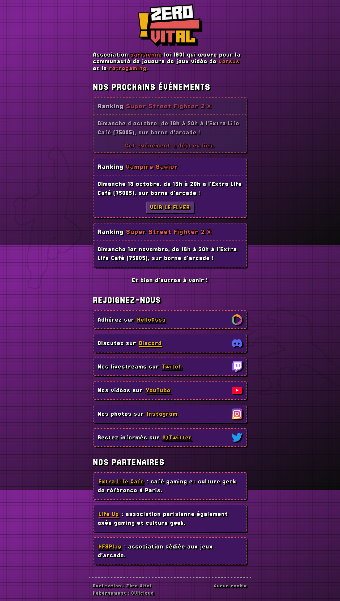

# Page de liens de l’association Zéro Vital

Disponible à l’adresse : [https://www.zerovital.fr](https://www.zerovital.fr/)

## Objectifs

- présenter la liste de tous les réseaux sociaux et les partenaires de l’association ;
- mettre en avant les prochains évènements ;
- être agréable à consulter et accessible ;
- être facile à modifier et à déployer ;
- être plus utile et moins cher qu’un « arbre à liens ».

## Liens

Aucun procédé particulier pour le gestion des liens, il faut les ajouter en dur dans le HTML.  
Les liens vers les réseaux sociaux peuvent être accompagnés d’un logo, qu’il faudra fournir et placer dans le dossier `/img`.

# Évènements

Les évènements sont ajoutés automatiquement dans la page via le script `events.js`.  
Le script prend la liste des évènements fournie par le fichier `events.json` (copier le fichier d’exemple `events.json.sample`).  
Si le fichier n’existe pas, la section « Nos prochains évènements » sera retirée de la page.

Pour ajouter un évènement, vous n’avez donc pas à toucher au code HTML, JavaScript ou CSS, juste `events.json`.

Chaque évènement est déclaré comme suit :

```
{
  "date": "2026-10-18",
  "type": "Ranking",
  "game": "Vampire Savior",
  "text": "Dimanche 18 octobre, de 16h à 20h à l’Extra Life Café (75005), sur borne d’arcade !",
  "flyer": {
    "img": "affiche_vsav_oct2026.webp",
    "alt": "Tournoi Vampire Savior\n Tarif : dès 13 euros\n Season Game 3 épisode 1\n Vampire Savior aka Darkstalkers 3 (arcade)\nDimanche 18 octobre de 16 heures à la fermeture\n Extra Life Café, 9 passage des patriarches, 75005 Paris"
  }
},
```

## Éléments obligatoires

Sans ces informations, ajouter un évènement n’a simplement pas de sens.

- `"date": "2026-10-18"` : la date au format YYYY-MM-DD. Elle n’apparait pas tel quel, mais sert à identifier l’évènement ;
- `"type": "Ranking"` : la partie « blanche » du titre, indiquant le type d’événements (ranking, tournoi, rencontre, etc.) ;
- `"game": "Vampire Savior"` : la partie « rouge » du titre, indiquant le ou les jeux concernés ;
- `"text": "Dimanche 18 octobre, de 16h à 20h à l’Extra Life Café (75005), sur borne d’arcade !"` : les détails de l’évènement, comme la date, l’horaire, le lieu, le prix, etc. Pour signifier un retour à la ligne, écrivez « `\n` ».

## Éléments facultatifs

On peut ajouter un flyer optionnel à chaque évènement. S’il n’y en a pas, omettez tout le bloc « flyer ».

Un flyer est composé d’une image et d’une version texte comprenant toutes les informations visibles sur l’image, pour assurer que des personnes aveugles ou malvoyantes puissent les consulter.

- `"img": "affiche_vsav_oct2026.webp"` : le nom du fichier qu’il faudra placer dans le dossier `/flyer` ;
- `"alt": "bla bla.\n bla bla."` : l’alternative textuelle qui reprend toutes les informations visibles sur l’image. Pour signifier un retour à la ligne, écrivez « `\n` ».

## Gestion du calendrier

En fonction de sa date, un évènement sera affiché ou non.

Pour le moment, les règles en place sont :

- afficher l’évènement mais le marqué comme « expiré » s’il a eu lieu il y a moins de 6 jours (pour montrer qu’il a bien eu lieu quand même) ;
- ne pas afficher l’évènement s’il a eu lieu il y a plus de 6 jours ou s’il aura lieu dans plus de 32 jours, afin de ne pas se retrouver avec une liste trop longue ;
- les autres évènements sont affichés normalement.

# Cookies

Dans nos jeux favoris, nous distribuons des pains mais sur notre site on ne distribue pas de cookie.  
Pas besoin, et pas envie de vous tracker non plus.  
Pour s’en assurer un script vérifie la présence de cookies et en affiche la liste (dans le pied de page) le cas échéant. À vous de vérifier et de les supprimer.  
Si un jour, le besoin de déposer un cookie purement technique arrive, nous le signalerons.

# Code

La page est simple, évitons de construire une usine autour.  
Pas de NodeJs, pas de paquet à installer et mettre à jour, pas de compilation, etc. Juste du HTML, du JavaScript et du CSS.  
Si seulement un jour, le support de TypeScript devenait natif…

Aucun LLM n’a été utilisé lors de la réalisation de ce site.  
Toute contribution utilisant l’IA ne sera pas rejetée pour autant, mais je vous demanderais de comprendre le code produit et les connaissances de vos actes.

# Aperçu

Capture d’écran datée du 10 octobre 2026.


